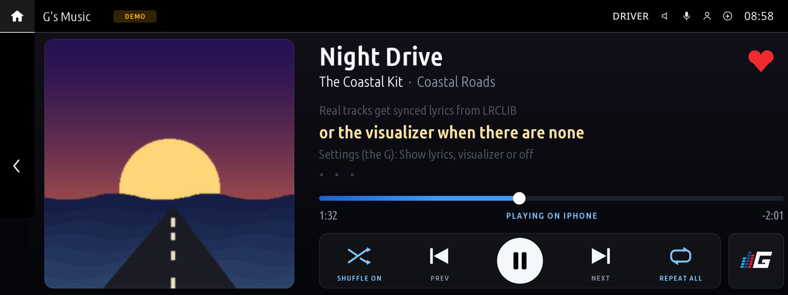

# idrive7-apps

Custom apps for BMW iDrive 7 head units. You install and update them from the car through
robertn_store, which builds each app on the head unit from this repository.

## Apps

### G's Dash (`ng_gsdash`)

A driver display and car hub for the centre screen.

- **Thirteen looks:** M Style, GT, Digital '84, Sim Racing, Lumen, Pixel, Vector, Desktop '98 (a
  late-90s desktop of grey windows and progress bars), Pocket (a pocket game console's green
  dot-matrix screen), Heist (an open-world crime game's HUD: a sunset city, a radar and wanted stars
  that climb with your speed), Arcade (an 80s racing cabinet: a night road, 1UP and HI-SCORE, INSERT
  COIN), Pod '04 (a mid-2000s pocket music player: your drive as Now Playing, revs round a touch
  wheel) and iDrive CCC (the first iDrive's start screen: taupe tiles, the silver centre button and
  its four coloured arrows), some with a choice of colours. Theme scrolls to show them all; pick a
  look's colours on Options' Theme card. Star your favourites and tap the gear on Drive to switch
  between them.
- **Pages:** swipe between Drive (shift lights, gear, rpm, speed, g-meter, drive mode, oil and coolant
  temperatures), Warm-up, G-force and Tires (tire pressures and temperatures).
- **Units:** mph or km/h, °F or °C, psi, bar or kPa.
- **Spotify panel:** optional, with its own sign-in by QR code.
- **Logo:** the G mark by default, on the home-screen widget and in the instrument cluster. Send your own
  GIF from your phone; it plays on the widget and in the cluster, including while the car is moving.
  Per driving mode (Logo, off by default) gives Comfort, Sport, Sport+ and any other mode the car reports
  its own GIF; an empty slot keeps the main Logo. Drive's right panel can show that same Logo instead of
  the G-meter or Spotify. A built-in Stage 1 / 2 / 3 example is original art; use your own GIFs for anything else.
- **On the car's other displays** (optional), two picks on Options > Cluster & HUD, one tap each, shared
  with G's Music and G's TV:
  - **The cluster's centre:** Auto, the G's Dash logo, G's Music, Waze's map or the car's own. Every
    pick but Auto always shows what it says, also during route guidance; Auto shows the directions
    during a route, then G's TV, G's Music or the logo.
  - **Dials & HUD:** your look on the cluster dials, G's Dash's HUD, G's Music's lyrics on the HUD, or
    the car's own. They share one display, so one of them at a time.

  These need the Cluster renderer tool from the Store. A single switch in Options puts the cluster and
  HUD back to stock.
  The cluster dials are built only for the instrument cluster's M layout. If your car doesn't use
  it, you can code it with BimmerCode.
- **CarPlay map in the cluster** (optional, off by default): needs the Waze on cluster tool from the
  Store and is untested on most firmware. To revert, turn it off and restart the head unit, or remove
  the tool. The Waze and Stock picks switch its map on and off in the cluster, and its HUD map stays
  off while one of G's apps has the HUD (Waze on cluster 0.9.0 or later).

### G's Music (`ng_spotify`)

A full-screen Spotify player with synced lyrics or a visualizer.

- Album art, large touch controls (previous, play/pause, next, shuffle, repeat, like) and a seek bar
  you tap or drag.
- Synced lyrics from [LRCLIB](https://lrclib.net), or a visualizer.
- Sign in by scanning a QR code with your phone.
- A home-screen widget showing what's playing.
- While music plays, lyrics (scrolling as in the app) or the visualizer in the instrument cluster, and
  the lyrics in the HUD when G's Dash's Dials & HUD pick is G's Music's lyrics (without G's Dash, its
  own HUD setting, off by default), in a small, medium or large size. Both need the Cluster renderer
  tool.

Needs Spotify Premium. Setup guide: [docs/spotify.md](docs/spotify.md).

### G's TV (`ng_tv`) - experimental

Video on the centre screen while parked.

- Channels from [Spelunkr](https://spelunkr.tv) (programmes on the Internet Archive) with a
  two-hour guide and channel up / down.
- Your own sources: direct links to MP4 (H.264) files, sent from your phone with a QR code or a
  6-digit code.
- Picks up where you left off.
- Optional playback in the HUD or the cluster, also only while parked: in the cluster while G's Dash's
  pick is Auto, in the HUD while its Dials & HUD pick is the car's own.

The picture shows only in P, at a standstill. Sound plays through the car's own media player and speakers
(experimental, Settings > Sound, on by default; it may not work on every car, and Test sound on that page checks).

## Requirements

- A BMW with an iDrive 7 head unit and robertn_store installed.
- **Internet** for G's Music, G's TV and G's Dash's Spotify panel: turn on the Store's uplink (phone
  hotspot or Wi-Fi).
- **Cluster and HUD features:** the Cluster renderer tool from the Store. The CarPlay map in the
  cluster also needs the Waze on cluster tool.

## Install

1. On the car, open **robertn_store → Settings → Add source**.
2. Enter `nickgcode/idrive7-apps` (or paste this repository's link) and save.
3. The apps appear in the Store's list. Choose one and tap **Install**.

Updates appear in the Store as well. To remove an app, uninstall it in the Store.

Nothing here contains BMW's SDK. The Store supplies it when it builds an app on the head unit; a
local build needs it in `oap-sdk/` (git-ignored). Never publish `dist/`, since builds contain the SDK.

## Support

Enjoying the apps? You can support development via [GitHub Sponsors](https://github.com/sponsors/nickgcode).

## Disclaimer

Unofficial. Not made, endorsed or supported by BMW or by the Store's author. Use at your own risk:
you are responsible for your car and for how you use these apps. Don't let them distract you while
driving.

## License

MIT, see [LICENSE](LICENSE). Bundled third-party code keeps its own licence:
[kit/LICENSE.idrive7-apps](kit/LICENSE.idrive7-apps), [apps/ng_gsdash/LICENSE](apps/ng_gsdash/LICENSE),
[apps/ng_spotify/LICENSE](apps/ng_spotify/LICENSE), [apps/ng_tv/LICENSE](apps/ng_tv/LICENSE).
