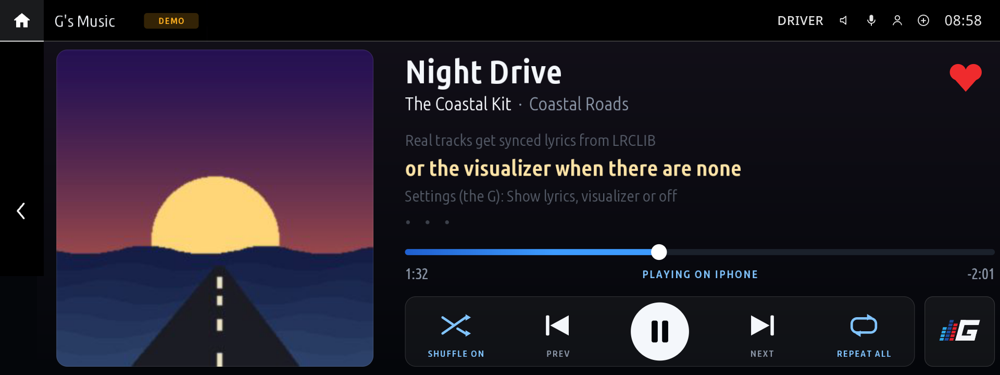
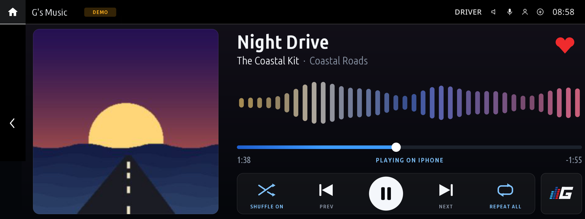
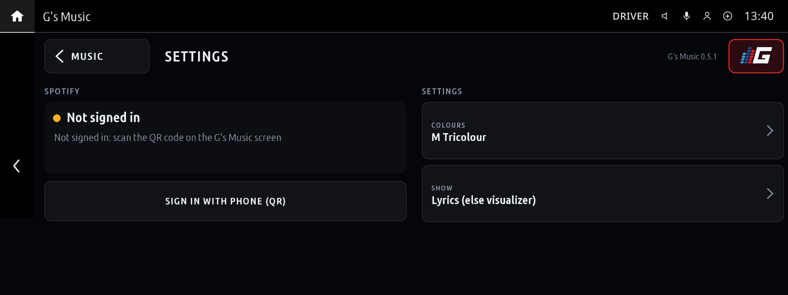
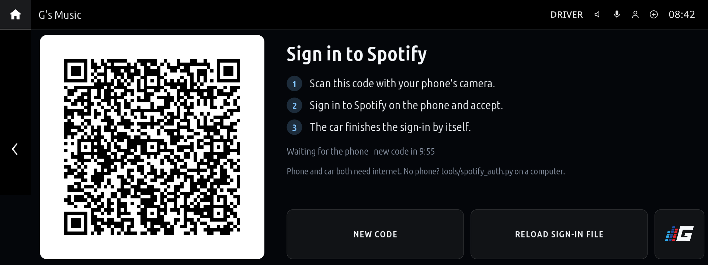
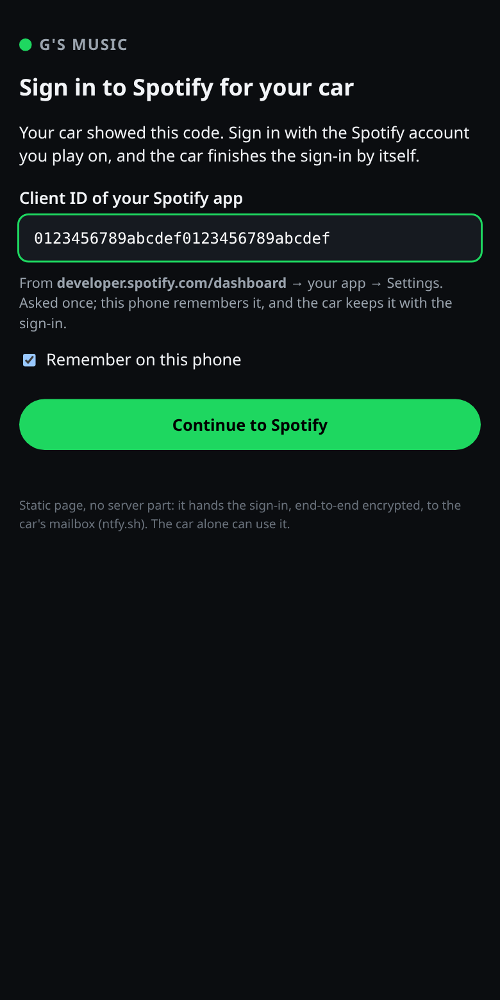
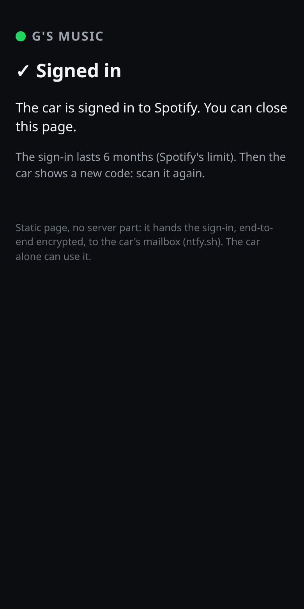

# G's Music for Spotify (`ng_spotify`)

Shows what your Spotify account is playing and controls it from one full-screen touch page: previous,
play/pause, next, shuffle, repeat, like, and tap or drag the progress bar to seek. Synced lyrics (from
[LRCLIB](https://lrclib.net)) or a visualizer show under the title. The **G** at the bottom right opens
the settings. There is also a home-screen widget.

| playing, with lyrics | the visualizer |
|---|---|
|  |  |

| settings (the G) | not signed in: the QR sign-in |
|---|---|
|  |  |

## What you need

- **Spotify Premium.**
- **Internet in the car:** turn on the uplink in the Store (phone hotspot or Wi-Fi).
- Spotify playing on a device, normally the phone connected to the car.

## Sign-in with the phone (QR)

When you are not signed in, the app shows a QR code (or tap the **G** → **Sign in with phone (QR)**).
Scan it with your phone, sign in at Spotify and accept. The car finishes by itself.

| on the car | on the phone | after |
|---|---|---|
|  |  |  |

The first time, the phone page asks for a Spotify app **Client ID**. Create one at
[developer.spotify.com/dashboard](https://developer.spotify.com/dashboard) (**Create app**, Web API),
add the sign-in page's address as a Redirect URI, and copy its Client ID. The phone remembers it.

Spotify sign-ins last 6 months. When it runs out the app shows the QR code again: scan it again. The
settings page shows the date.
